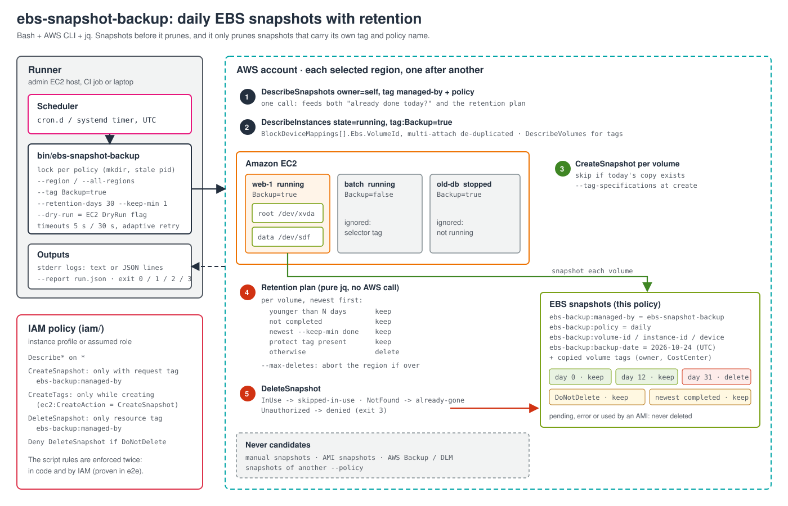
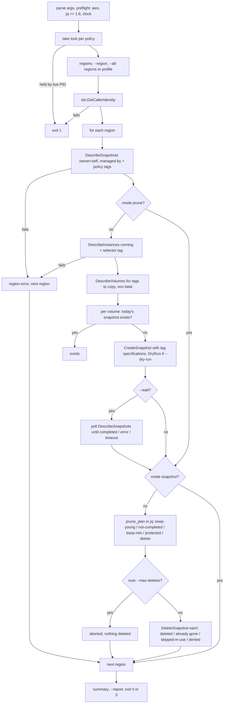
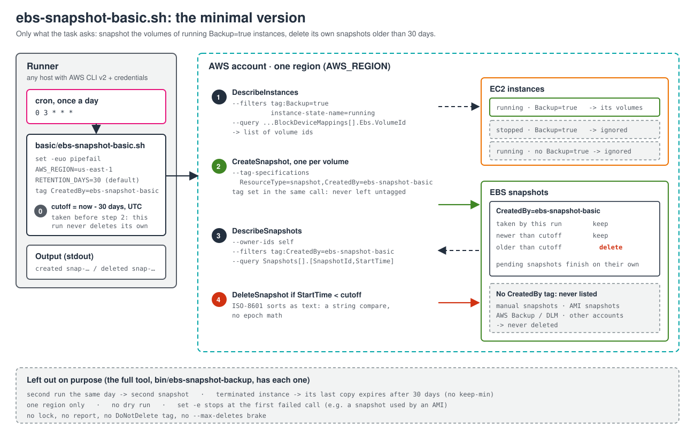
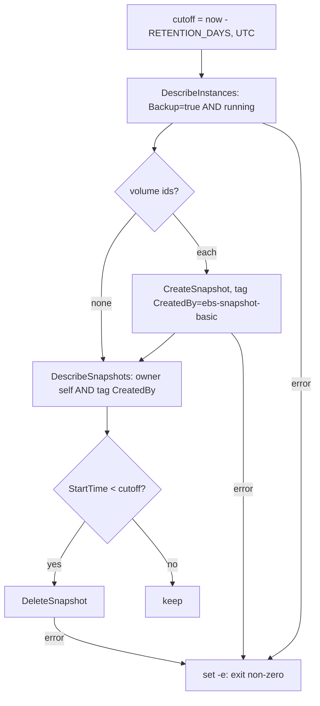

# Build guide: what gets built first, and why

This guide covers the project in two orders:

1. **Authoring order**: how to write this repository from scratch, step by step.
   Each step only depends on what the previous steps already defined.
2. **Execution order**: what happens, call by call, on every run.

Section 3 does the same for the **minimal version**
([`basic/ebs-snapshot-basic.sh`](../basic/ebs-snapshot-basic.sh)), which does
only what the task asks. Start there if you want the idea before the safety
features.

---

## 1. Authoring order (how to build the repository)

The commit history follows these steps, so `git log --reverse` shows the same path
(steps 2–6 land in one commit: the script is a single file on purpose, so it can be
copied to a host as-is).

| Step | Files | What | Why it comes here |
|---|---|---|---|
| 0 | — | **Design on paper**: which snapshots may ever be deleted, what "already done today" means, what happens when a run dies halfway | A retention script that deletes the wrong snapshot is worse than none. Ownership tags, create-before-delete and `keep-min` are decided before any code. |
| 1 | `.gitignore`, `.editorconfig`, `LICENSE` | Skeleton | Reports, logs and Terraform state hold account and resource IDs: ignored **before** the first run produces them. `.editorconfig` is what `shfmt` reads. |
| 2 | `bin/ebs-snapshot-backup`: argument parsing, logging, `aws_ec2` wrapper, lock | The frame every later function uses | Logging and error capture (`AWS_ERR_CODE`) must exist before any AWS call is written, or each call grows its own ad-hoc handling. |
| 3 | discovery: `load_managed_snapshots`, `discover_targets`, `load_volume_tags` | Read-only calls | Nothing can be created or deleted correctly before the inputs are right, and read-only code is safe to run against a real account early. |
| 4 | `snapshot_volume`, `snapshot_region`, `wait_for_snapshots` | Create, idempotent per UTC day | The backup half of the task. It comes before retention so that every later test run leaves something to prune. |
| 5 | `prune_plan`, `prune_region`, `delete_snapshot` | Retention as a pure `jq` function, then the deletes | The riskiest part. Keeping the decision in a pure function means every rule is testable without AWS. |
| 6 | `summarize`, `main` | Report, exit codes, region loop | Thin layer that wires steps 2–5 together. |
| 7 | `tests/helpers`, `tests/unit` | Fake `aws` + bats | Locks in behaviour, including the error paths (`InUse`, `Unauthorized`, throttling) that are hard to trigger for real. |
| 8 | `tests/integration` | Real AWS CLI against moto | The fake `aws` cannot prove the CLI accepts the arguments or that the real response shapes parse. moto can. |
| 9 | `iam/ebs-snapshot-backup-policy.json` | Least privilege | The permission set is only known once the calls are final. |
| 10 | `.github/workflows/ci.yml` | shellcheck, shfmt, unit on Linux + macOS, integration, Terraform validate | Turns steps 2–9 into a gate. macOS runs the tests on bash 3.2, the oldest supported. |
| 11 | `examples/` | cron and systemd | How it is actually scheduled, with exit code 3 wired to alerting. |
| 12 | `e2e/aws` | Real fleet + role with the `iam/` policy + `run-e2e.sh` | moto does not enforce IAM. Only a real account proves the tag conditions and the explicit Deny. |
| 13 | `README.md`, `docs/` | Usage, safety, limitations, diagram, this guide | Documents what was actually built, so it is written last. |

### Key decisions made in step 0

| Decision | Choice | Reason |
|---|---|---|
| Which snapshots may be deleted | Only those tagged `ebs-backup:managed-by=ebs-snapshot-backup` **and** the same `ebs-backup:policy` | "Older than 30 days" alone would hit AMI snapshots, manual copies and AWS Backup recovery points. The policy tag lets a daily/7d and a monthly/365d schedule coexist. |
| Where the rule lives | In the script **and** in IAM (`aws:ResourceTag` on delete, `aws:RequestTag` on create, `ec2:CreateAction` on tags, Deny on `DoNotDelete`) | A bug in the script, or someone running a modified copy with the same role, still cannot delete foreign snapshots. |
| Order | Create first, then prune | If the run dies between the two, there are more copies, never fewer. |
| Last copy | `--keep-min 1` newest **completed** snapshot per volume is kept regardless of age | A volume whose instance was terminated or untagged would otherwise lose its last backup after 30 days. A `pending` snapshot is not a backup yet, so it does not count. |
| Idempotency key | Volume + policy + UTC date, stored as a tag | Re-running after a crash or by hand the same day creates nothing. UTC so that a timezone change on the host does not create or skip a day. |
| Tags at creation | `--tag-specifications` on `CreateSnapshot` | Create-then-tag leaves an untagged snapshot if the second call fails, and the IAM condition requires the tag on the create request. |
| Where the volume list comes from | `DescribeInstances` block device mappings, not `DescribeVolumes` with an attachment filter | The selector is a tag on the **instance**; the instance call returns its volumes directly. Multi-attach volumes are de-duplicated. |
| Retention logic | A pure `jq` function over a normalised list | No AWS calls, so every rule (boundary day, keep-min per volume, pending, protected) is a fast unit test. |
| Dry run | EC2's own `DryRun` flag, not "print what I would do" | AWS evaluates the real permissions, including tag conditions: a dry run that passes means the real run will be allowed. |
| Failure model | Per volume / snapshot / region results, keep going, exit `3` | One throttled volume or one disabled region must not stop the backups of everything else; cron/systemd still sees a non-zero exit. |
| Network | 5 s connect, 30 s read, adaptive retry, 8 attempts | Lesson from exercise #3: botocore defaults let one dead endpoint stall a run for ~20 minutes. |
| Concurrency | `mkdir` lock per policy with PID, stale lock removal | `flock` is not on macOS. Two runs of one policy would race on the "already done today" check; different policies are independent. |
| Portability | bash 3.2 (no associative arrays, no `mapfile`), `jq` for dates | `date -d` (GNU) and `date -v` (BSD) differ; `jq`'s `fromdateiso8601`/`strftime` behave the same everywhere. |
| Testing time | `EBS_BACKUP_NOW` overrides the clock | Retention depends on age; moving the clock 31 days is the only way to test rotation without waiting a month, in moto and in the real account. |

---

## 2. Execution order (what happens on each run)

### Provisioning order for the e2e harness (`e2e/aws`)

1. `random_id` → the suffix for the selector tag key and the policy name, so
   nothing else in the account can match.
2. Data sources: default VPC/subnet, AL2023 arm64 AMI from SSM.
3. Instances (backed, unselected, stopped) and the data volume, then the
   attachment, then `aws_ec2_instance_state` to stop the third one.
4. The manual snapshot (depends on the data volume).
5. IAM role trusted by the caller, with the policy file from `iam/` read via
   `file()`, so the e2e always tests the policy that ships.
6. `run-e2e.sh` waits for the role to be assumable (IAM is eventually
   consistent), then runs the checks; the script's own prune deletes every
   snapshot it made before `terraform destroy`.

---

## 3. The minimal version (`basic/ebs-snapshot-basic.sh`)

Under 50 lines, AWS CLI only (no `jq`). It keeps one safeguard from the full
tool, the ownership tag, because without it step 3 would delete **any** old
snapshot in the account: AMI snapshots, someone's manual copy, AWS Backup
recovery points.

### Authoring order

| Step | What | Why it comes here |
|---|---|---|
| 1 | `set -euo pipefail`, `RETENTION_DAYS` (default 30), the tag `CreatedBy=ebs-snapshot-basic` | Every later step uses them. The tag is decided first because creation and deletion must agree on it. |
| 2 | The cutoff, `now - RETENTION_DAYS` in UTC, computed **before** any snapshot is created | If it were computed after the snapshots are created, one taken a second earlier could fall before it and be deleted by the same run (seen in moto with `RETENTION_DAYS=0`). `date -d` is GNU (Linux), `date -v` is BSD (macOS): try one, fall back to the other. |
| 3 | `describe-instances` with `tag:Backup=true` and `instance-state-name=running`, `--query` down to `Ebs.VolumeId`, `--output text` | Read-only and safe to run first. Two filters are an AND, applied by AWS. |
| 4 | `create-snapshot` per volume with `--tag-specifications` | Tags set in the creating call: if a separate `create-tags` failed, the snapshot would stay untagged and retention would never see it. |
| 5 | `describe-snapshots --owner-ids self` filtered by the tag, `--query [SnapshotId,StartTime]`, then `delete-snapshot` when `StartTime < cutoff` | Last, so a run that dies halfway leaves more copies, never fewer. ISO-8601 timestamps sort as text, so a string comparison replaces date arithmetic. |
| 6 | `tests/integration/basic.bats` | Real AWS CLI against moto: the right volumes are picked, young snapshots stay, old own snapshots go, this run's and untagged ones stay. CI runs it on Linux, so the `date -d` branch is covered too. |

### Execution order

### What the full tool adds, and why

| Gap in the minimal version | What happens | Full tool |
|---|---|---|
| No idempotency | Two runs on the same day take two snapshots per volume | One snapshot per volume, policy and UTC day (`ebs-backup:backup-date` tag) |
| No `keep-min` | When an instance is terminated or untagged, its last copy expires after 30 days | The newest **completed** snapshot of each volume is always kept |
| Any error stops the run | A snapshot used by an AMI (`InvalidSnapshot.InUse`) aborts the rest of the deletes | Per-snapshot results (`skipped-in-use`, `denied`...), keeps going, exit `3` |
| One region | Only `AWS_REGION` | `--region` (repeatable) or `--all-regions` |
| No dry run, lock, report, `DoNotDelete` or `--max-deletes` | Nothing to preview, nothing stops two runs at once or a mass delete | All of them, plus an IAM policy that enforces the tag rules |

